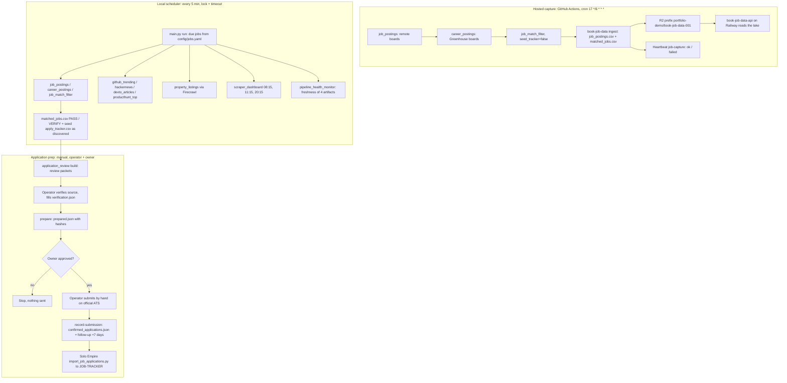
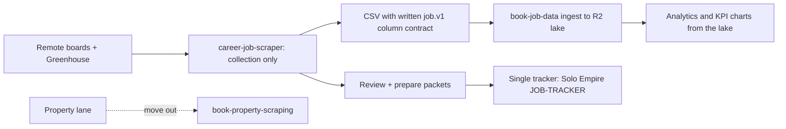

# 01 — Business process (As-Is / To-Be)

ระบบนี้เป็น producer ของข้อมูลประกาศงาน (job discovery capture) + เครื่องมือเตรียมใบสมัครของ operator คนเดียว
ไม่มี web app และไม่มี server ของตัวเอง "deploy" คือข้อมูลที่ถูก ingest เข้า R2 ทุก 6 ชั่วโมง

## As-Is (จากโค้ดวันนี้)

มีสองเส้นทางที่รันจริง:

1. **Hosted capture (Track B)** บน GitHub Actions: `scheduled-capture.yml` → `scripts/cloud_capture.py` รัน 3 job → `book-job-data` ingest เข้า R2
2. **Local scheduler** บนเครื่อง operator (Windows Task Scheduler / cron ทุก 5 นาที): `scripts/scheduled_run.py` → `main.py run` (9 job ที่ `enabled: true`) → `pipeline_health_monitor.py`
   และ flow เตรียมใบสมัครแบบ manual (`application_review.py build / prepare / record-submission`)

Sources: `.github/workflows/scheduled-capture.yml`, `scripts/cloud_capture.py`, `scripts/scheduled_run.py`, `ops/windows/scheduled-task.ps1`, `setup_cron.sh`, `config/jobs.yaml`, `scripts/filter_job_matches.py`, `scripts/application_review.py`, `CAREER-WORKFLOW.md`, `RUNBOOK.md`

Lane รอง (property, Facebook Group posts ผ่าน Chrome extension) เป็น flow ของ operator แบบ manual: capture แท็บที่เปิด → export CSV → importer offline → review queue
แถวเริ่มที่ `review_decision=pending`, `outreach_status=not_contacted` เสมอ (ดู [11-state-machines.md](11-state-machines.md))

## To-Be (จาก PRODUCT.md, docs/UPGRADE-PLAN.md, specs/)

แหล่งที่ระบุทิศทางในอนาคต:

| Item | ที่มา |
|---|---|
| Bridge/retire dual tracker (`data/apply_tracker.csv` vs Solo Empire JOB-TRACKER) | `PRODUCT.md` §Claim hygiene (Planned) |
| เขียน CSV column contract ที่ `book-job-data` ใช้ (job.v1) | `PRODUCT.md` §Next improvements 2, `DOCPACK/08-rtm.md` GAP-01 |
| repo นี้เป็น collection-only, analytics ไปที่ lake | `PRODUCT.md` §Next improvements 4 |
| ย้าย lane property ไป `book-property-scraping` | `BOUNDARY.md` Status (2026-09-30) |
| Per-run counts chart (KPI-L-01..03) | `docs/measurement/KPI-PLAN.md` §Dashboards |
| Windows CI ครอบคลุม offline suite ทั้งหมด, แยก requirements runtime/extra | `docs/UPGRADE-PLAN.md` P1/P2 |

Sources: `PRODUCT.md`, `BOUNDARY.md`, `docs/UPGRADE-PLAN.md`, `docs/measurement/KPI-PLAN.md`, `DOCPACK/08-rtm.md`

## Open questions

- To-Be ของ application tracker: จะเลิกใช้ `apply_tracker.csv` เมื่อไหร่ และ JOB-TRACKER เป็น source of record เดียวหรือไม่ (ยังเป็น Planned)
- `property_listings` (Firecrawl, ddproperty) ยัง `enabled: true` ในขณะที่ BOUNDARY บอกว่า property จะย้ายออก: เป็นของ lane ไหนในระยะยาว
- Discovery feeds (GitHub trending, HN, dev.to, Product Hunt) ไม่มีผู้ใช้ปลายทางที่ระบุ (`DOCPACK/08-rtm.md` GAP-04)
