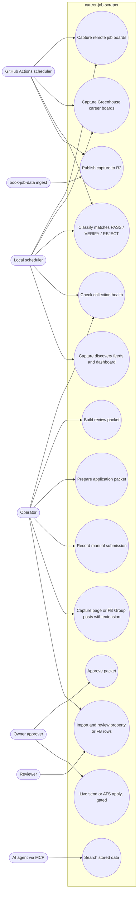

# 02 — Use cases

ไม่มีระบบ login; "บทบาท" มาจากการเข้าถึงเครื่อง, env และ flag บน CLI (`DOCPACK/05-srs.md` §1)
actor ด้านล่างคือบทบาทที่โค้ดแยกสิทธิ์จริง:

| Actor | กลไกในโค้ด |
|---|---|
| GitHub Actions scheduler | `scheduled-capture.yml` cron + secrets R2/heartbeat/Sentry |
| Local scheduler | `scheduled_run.py` จาก Task Scheduler / cron |
| Operator | รันสคริปต์ใน `scripts/`, Chrome extension, MCP |
| Owner (approver) | `prepare --owner-approved`, env `BOOK_JOB_LIVE_SEND_ENABLED=1` + `BOOK_JOB_SEND_UNLOCK` |
| Reviewer (property / FB lane) | `review_property_leads.py`, `review_facebook_group_posts.py` ต้องมี reviewer ID |
| AI agent | `mcp_server/server.py` tools |
| book-job-data (ระบบภายนอก) | อ่าน CSV, เขียน R2 |

Sources: `.github/workflows/scheduled-capture.yml`, `scripts/cloud_capture.py`, `scripts/scheduled_run.py`, `config/jobs.yaml`, `scripts/application_review.py`, `scripts/safety.py`, `SAFETY.md`, `chrome-extension/manifest.json`, `scripts/import_property_leads.py`, `scripts/import_facebook_group_posts.py`, `scripts/review_property_leads.py`, `scripts/review_facebook_group_posts.py`, `mcp_server/server.py`, `DOCPACK/05-srs.md`

หมายเหตุ: UC10 (live send/apply) มีโค้ดอยู่ (`send_application_emails.py`, `ats_auto_apply.py` ฯลฯ) แต่ล็อกโดยค่าเริ่มต้น ต้องผ่าน flag + 2 env + `PASS` + `APPROVED` (`SAFETY.md`)

## Open questions

- MCP server (`mcp_server/server.py` `main()`) แค่พิมพ์รายการ tool และบอกให้ "integrate with MCP SDK": ยังไม่มี transport จริง ใช้งานจาก agent ได้จริงหรือไม่
- Reviewer เป็นคนเดียวกับ owner หรือไม่ (solo operator ตาม `RUNBOOK.md` §Owner)
