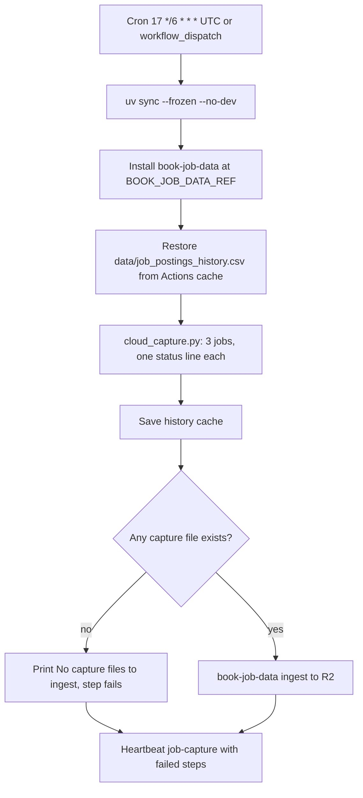
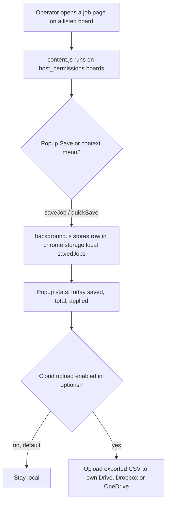
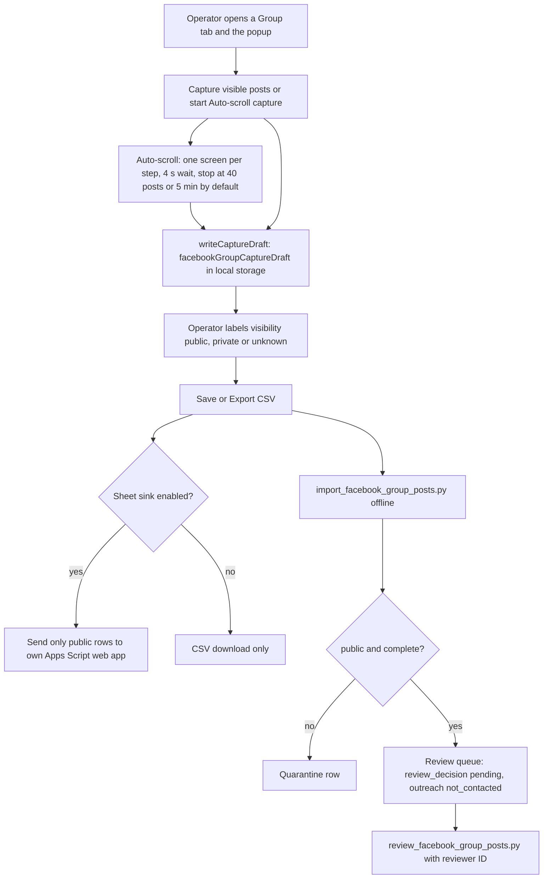

# 03 — User flows

**Reused:** flow หลักของ operator มีอยู่แล้วใน [`DOCPACK/06-ux-flows.md`](../../DOCPACK/06-ux-flows.md)
(2.1 จากประกาศงานถึงใบสมัครที่มีหลักฐาน, 2.2 gate ของ sender, 2.3 health รายวัน และ screen inventory SC-01..SC-10)
ไฟล์นี้เพิ่มเฉพาะ flow ที่ยังไม่มีในเอกสารเดิม: hosted capture (ไม่มีมนุษย์), Chrome extension และ property/FB review

ไม่มี web route หรือ page; "หน้าจอ" คือ CLI, ไฟล์ review packet, popup ของ extension และ MCP tools

## Flow A — Hosted capture (ไม่มี operator)

Sources: `.github/workflows/scheduled-capture.yml`, `scripts/cloud_capture.py`, `specs/cloud-capture-pipeline.md`

## Flow B — Operator: save a job page with Quick Saver

Sources: `chrome-extension/manifest.json`, `chrome-extension/background.js`, `chrome-extension/popup.js`, `chrome-extension/cloud.js`

## Flow C — Operator: Facebook Group posts to review queue

Sources: `chrome-extension/popup.js`, `chrome-extension/background.js`, `chrome-extension/sheet.js`, `integrations/google-sheet/Code.gs`, `scripts/import_facebook_group_posts.py`, `scripts/review_facebook_group_posts.py`, `contracts/facebook-group-post.v1.json`, `SAFETY.md`

## Open questions

- `DOCPACK/06-ux-flows.md` 2.1 เขียนว่า "Scheduler เก็บงาน ทุก 6 ชม." แต่ local tick ทุก 5 นาทีและ job ถึงเวลาตาม `is_due()` (6h): ถูกต้องในแง่ job แต่ควรระบุว่ามีสอง scheduler
- Popup นับ `applied` จาก stats ของ extension: ค่านี้สัมพันธ์กับสถานะ `submitted` ใน ledger หรือไม่
