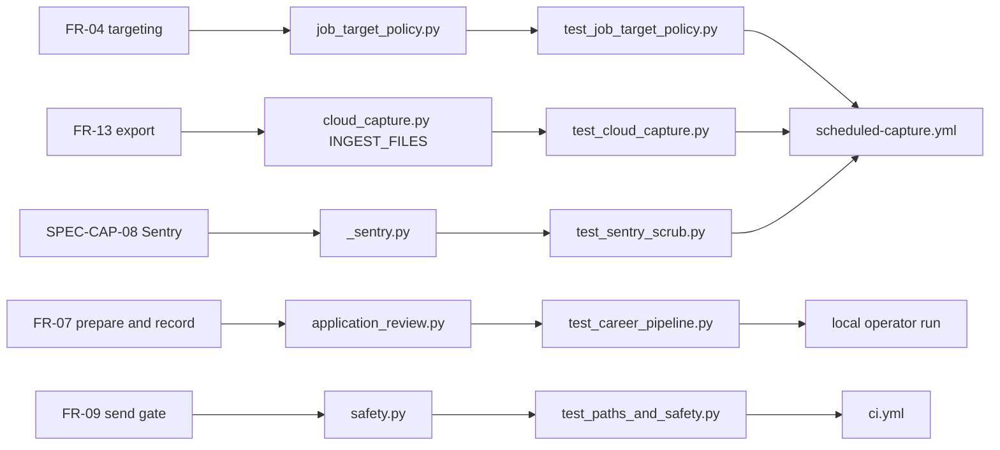

# 04 — Traceability (RTM)

**Reused + extended:** RTM เดิม FR ↔ US ↔ surface ↔ TC อยู่ใน [`DOCPACK/08-rtm.md`](../../DOCPACK/08-rtm.md)
ไฟล์นี้เพิ่มคอลัมน์ code module, test file จริง และ workflow/release ที่ทำให้ requirement ไปถึง production
และเพิ่ม SPEC-CAP-01..10 จาก [`specs/cloud-capture-pipeline.md`](../../specs/cloud-capture-pipeline.md)

## FR (DOCPACK/05-srs.md)

| Req | Code module | Test file | Workflow / release path |
|---|---|---|---|
| FR-01 scheduler, lock, timeout, log rotate | `main.py`, `adapters/inbound/scheduler_adapter.py`, `scripts/scheduled_run.py`, `scripts/file_lock.py` | `tests/test_scheduled_run.py`, `tests/test_file_lock.py`, `tests/test_atomic_writes.py` | `ci.yml` scraper + windows-scheduler; local Task Scheduler |
| FR-02 remote board capture | `scripts/scrape_job_postings.py`, `scripts/http_policy.py` | `tests/test_http_policy.py`, `tests/test_job_history_dedup.py` | `scheduled-capture.yml` (job_postings) |
| FR-03 Greenhouse discovery | `scripts/career_discovery.py`, `config/career_sources.yaml` | `tests/test_career_pipeline.py` | `scheduled-capture.yml` (career_postings) |
| FR-04 targeting policy | `scripts/job_target_policy.py`, `scripts/filter_job_matches.py`, `config/job_targeting.yaml` | `tests/test_job_target_policy.py`, `tests/test_career_pipeline.py` | `scheduled-capture.yml` (job_match_filter) |
| FR-05 description enrichment | `scripts/scrape_job_descriptions.py` | none found | local only |
| FR-06 seed tracker | `scripts/auto_seed_tracker.py` | none found (gap) | local only (`seed_tracker: true` in `config/jobs.yaml`; off in cloud) |
| FR-07 review / prepare / record-submission | `scripts/application_review.py` | `tests/test_career_pipeline.py` | local only |
| FR-08 draft generators | `scripts/auto_apply.py`, `scripts/tailor_resume.py`, `scripts/cover_letter_generator.py`, `scripts/multi_resume_manager.py` | partial: `tests/test_paths_and_safety.py` | local only |
| FR-09 live send gate | `scripts/safety.py`, senders in `scripts/` | `tests/test_paths_and_safety.py`, `tests/test_process_security.py` | `ci.yml` |
| FR-10 source coverage registry | `scripts/source_coverage.py`, `config/source_coverage.yaml` | `tests/test_source_coverage.py` | `ci.yml` |
| FR-11 health monitor | `scripts/pipeline_health_monitor.py`, `scripts/pipeline_runner.py` | `tests/test_health_staleness.py` | local tick step 2 |
| FR-12 Thai cleaner, dedup | `core/pipeline/cleaner.py`, `core/pipeline/deduplicator.py`, `adapters/outbound/storage_adapter.py` | `tests/test_core_pipeline.py`, `tests/test_use_cases_and_storage.py`, `tests/test_bug_pattern_sweep.py` | `ci.yml` |
| FR-13 export to book-job-data | `scripts/cloud_capture.py` (`INGEST_FILES`) | `tests/test_cloud_capture.py` (IngestInputsTest); no column contract test | `scheduled-capture.yml` step Ingest into R2 |
| FR-14 JOB-TRACKER handoff | `data/confirmed_applications.json` writer in `scripts/application_review.py` | `tests/test_career_pipeline.py` (ledger); importer test lives in Solo Empire | manual |
| FR-15 MCP search | `mcp_server/server.py`, `core/use_cases.py` SearchUseCase | `tests/test_use_cases_and_storage.py` (SearchUseCase, not MCP) | none |
| FR-16 property + extension + FB | `property/`, `chrome-extension/`, `scripts/import_property_leads.py`, `scripts/import_facebook_group_posts.py` | `tests/test_property_*.py`, `tests/test_facebook_group_*.py`, `tests/test_chrome_extension_*.py`, `tests/js/*.test.js` | `ci.yml` (Python); JS tests via node when present |
| FR-17 discovery feeds + dashboard | `scripts/scrape_github_trending.py`, `scrape_hackernews.py`, `scrape_devto.py`, `scrape_producthunt.py`, `scraper_dashboard.py` | none found (gap) | local only |

## SPEC-CAP (hosted capture)

| Req | Code | Test | Workflow |
|---|---|---|---|
| SPEC-CAP-01 trigger, concurrency, timeout | — | workflow review | `scheduled-capture.yml` `on`, `concurrency`, `timeout-minutes: 30` |
| SPEC-CAP-02 frozen install, pinned book-job-data | `uv.lock` | run log | steps Install scraper / Install book-job-data |
| SPEC-CAP-03 three jobs, seed_tracker off | `scripts/cloud_capture.py` `CLOUD_JOBS`, `PARAM_OVERRIDES` | `tests/test_cloud_capture.py` CloudJobsTest | step Capture |
| SPEC-CAP-04 counts-only public log | `_to_log()` | `tests/test_cloud_capture.py` RunTest | step Capture |
| SPEC-CAP-05 failure isolation | `run()` | `tests/test_cloud_capture.py` RunTest | step Capture |
| SPEC-CAP-06 ingest what landed | `ingest_inputs()` | `tests/test_cloud_capture.py` IngestInputsTest | step Ingest into R2 |
| SPEC-CAP-07 heartbeat | — | none (KPI-PLAN check 5 open) | step Heartbeat |
| SPEC-CAP-08 Sentry errors only | `scripts/_sentry.py` | `tests/test_sentry_scrub.py`, `tests/test_cloud_capture.py` ErrorReportingTest | step Capture env `SENTRY_DSN` |
| SPEC-CAP-09 history cache | — | workflow review | steps Restore / Save capture history |
| SPEC-CAP-10 no private material | `PARAM_OVERRIDES`, `INGEST_FILES` | `tests/test_cloud_capture.py` | workflow secrets |

Sources: `DOCPACK/05-srs.md`, `DOCPACK/08-rtm.md`, `DOCPACK/07-test-uat.md`, `specs/cloud-capture-pipeline.md`, `scripts/cloud_capture.py`, `scripts/_sentry.py`, `.github/workflows/ci.yml`, `.github/workflows/scheduled-capture.yml`, `config/jobs.yaml`, `tests/`

ไม่มี release tag หรือ version ของ repo; "release" = commit บน `main` ที่ capture รอบถัดไป checkout (ดู [18-git-release-workflow.md](18-git-release-workflow.md))

## Open questions

- FR-05, FR-06, FR-17 ไม่มี test เฉพาะ (ตรงกับ GAP-02, GAP-04 ใน DOCPACK)
- FR-13 ยังไม่มี column contract ใน repo นี้ (GAP-01)
- SPEC-CAP-07 (heartbeat alert fires on failure) ยังไม่เคยทดสอบ (`docs/measurement/KPI-PLAN.md` verification #5)
