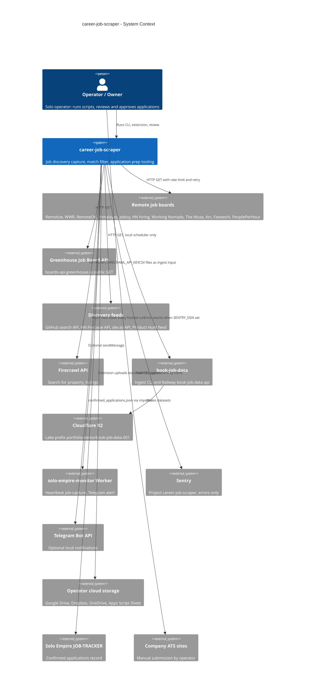

# 05 — C4 Context

ภาพระดับระบบ: career-job-scraper เป็น producer ที่ดึงประกาศงานสาธารณะและส่งไฟล์ CSV ให้ `book-job-data`
บริบทเดิมแบบ flowchart อยู่ใน [`DOCPACK/02-architecture.md`](../../DOCPACK/02-architecture.md) §1 (บอร์ดในภาพเดิมบางตัว เช่น Dice, Wellfound ไม่อยู่ใน `boards` ของ `job_postings` แล้ว)

Sources: `config/jobs.yaml`, `config/career_sources.yaml`, `scripts/scrape_job_postings.py`, `scripts/career_discovery.py`, `scripts/scrape_property_listings.py`, `.github/workflows/scheduled-capture.yml`, `scripts/_sentry.py`, `scripts/pipeline_health_monitor.py`, `chrome-extension/cloud.js`, `chrome-extension/sheet.js`, `integrations/google-sheet/Code.gs`, `CAREER-WORKFLOW.md`, `PRODUCT.md`

## Open questions

- Railway `job-radar` (Track A) alert บนบอร์ดเดียวกัน แต่เป็นระบบแยก ไม่ได้เรียกจาก repo นี้ (`specs/cloud-capture-pipeline.md` §Context): ควรอยู่ในภาพ context หรือไม่
