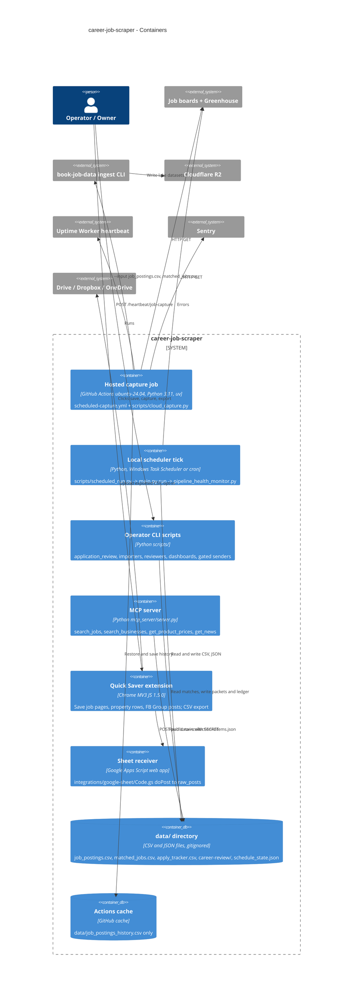

# 06 — C4 Container

"Container" ที่นี่คือหน่วยที่รันแยกกันจริง: workflow บน GitHub Actions, process Python บนเครื่อง operator, Chrome extension, Apps Script และ data directory

Sources: `.github/workflows/scheduled-capture.yml`, `scripts/cloud_capture.py`, `scripts/scheduled_run.py`, `main.py`, `mcp_server/server.py`, `chrome-extension/manifest.json`, `chrome-extension/sheet.js`, `chrome-extension/cloud.js`, `integrations/google-sheet/Code.gs`, `adapters/outbound/storage_adapter.py`, `DOCPACK/02-architecture.md` §4

หมายเหตุ: hosted capture ไม่ได้เขียน `data/` ถาวร: runner ทิ้งไฟล์ทุก run เหลือเฉพาะ history ใน Actions cache

## Open questions

- ระบบ `scripts/scrape_facebook_group_background.py` (Playwright opt-in) และ `ops/systemd/facebook-group-background.*.example` เป็น container ที่ถูก install จริงบนเครื่องไหนหรือไม่ (ไฟล์เป็น `.example`)
