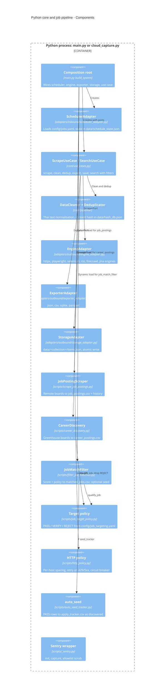

# 07 — C4 Component

Component ของ Python core (hexagonal: `core/` + `adapters/`) และ job scripts ที่ scheduler โหลดแบบ dynamic
(`main.load_category_scraper` อ่าน `scraper_module` / `scraper_class` จาก `config/jobs.yaml`)
ตาราง component เดิมอยู่ใน [`DOCPACK/02-architecture.md`](../../DOCPACK/02-architecture.md) §2

Sources: `main.py`, `core/use_cases.py`, `core/ports.py`, `core/pipeline/cleaner.py`, `core/pipeline/deduplicator.py`, `adapters/inbound/scheduler_adapter.py`, `adapters/outbound/engine_adapter.py`, `adapters/outbound/exporter_adapter.py`, `adapters/outbound/storage_adapter.py`, `scripts/scrape_job_postings.py`, `scripts/career_discovery.py`, `scripts/filter_job_matches.py`, `scripts/job_target_policy.py`, `scripts/http_policy.py`, `scripts/auto_seed_tracker.py`, `scripts/_sentry.py`, `config/jobs.yaml`

หมายเหตุ: job ที่มี `scraper_module` (ทุก job ที่ enabled) ไม่ผ่าน `ScrapeUseCase`; `execute_job` เรียก `scraper.run()` ตรง ส่วน `ScrapeUseCase` ใช้เมื่อ job ไม่มี module (generic engine path)

## Open questions

- `scripts/job_role_relevance.py`, `scripts/job_dedup.py` ถูกเรียกจาก job ไหนใน path ที่ schedule จริง (ไม่ได้ trace ลึกในรอบนี้)
