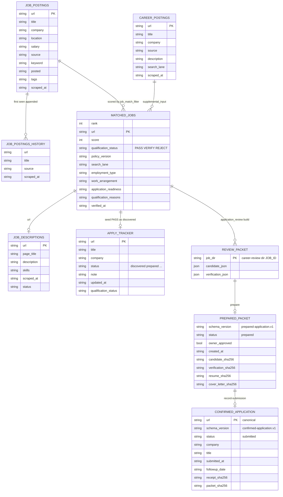
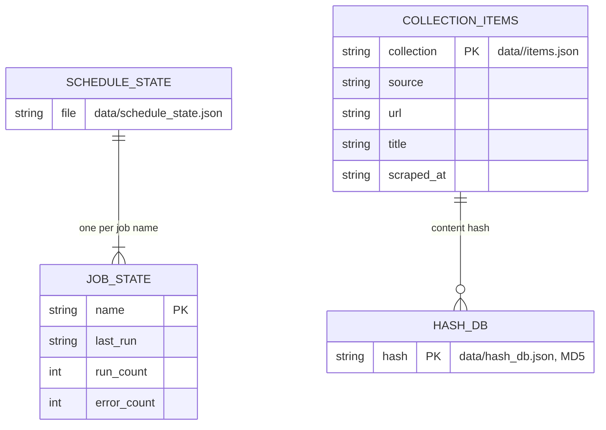
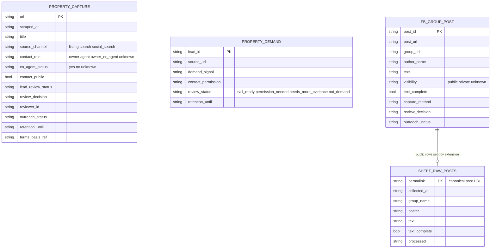

# 09 — ERD (file-based data model)

ไม่มี database server ข้อมูลที่ persist คือไฟล์ CSV/JSON ใต้ `data/` (gitignored) และ JSON schema ใน `contracts/`
"entity" ด้านล่าง = ไฟล์หนึ่งชนิด, "key" = field ที่โค้ดใช้ dedup หรือ join (ส่วนใหญ่คือ `url`)
field ที่แสดงตัดมาเฉพาะที่สำคัญ; รายการเต็มอยู่ใน `fieldnames` ของสคริปต์ที่อ้าง

## Job lane

Sources: `scripts/scrape_job_postings.py` (`save_jobs`, `append_history`), `scripts/career_discovery.py` (`FIELDS`), `scripts/filter_job_matches.py` (`fieldnames`), `scripts/job_target_policy.py` (`HUMAN_VERIFICATION_FIELDS`, `SOURCE_EVIDENCE_FIELDS`), `scripts/scrape_job_descriptions.py`, `scripts/auto_seed_tracker.py` (`POLICY_FIELDS`), `scripts/application_review.py`

## Ops and core stores

Sources: `adapters/inbound/scheduler_adapter.py`, `adapters/outbound/storage_adapter.py`, `core/models.py`, `core/pipeline/deduplicator.py`, `docs/UPGRADE-PLAN.md` P2 (MD5)

## Property / Facebook Group lane (contracts)

Sources: `contracts/property-capture.v1.json`, `contracts/property-demand.v1.json`, `contracts/facebook-group-post.v1.json`, `integrations/google-sheet/Code.gs` (`HEADER`), `chrome-extension/sheet.js`

## Open questions

- Column contract ของ `job_postings.csv` / `matched_jobs.csv` ที่ `book-job-data` (job.v1) คาดหวังไม่อยู่ใน repo นี้ (`DOCPACK/08-rtm.md` GAP-01)
- `apply_tracker.csv` ยังมี `application_tracker.json` (`scripts/app_tracker.py`, stage `discovered`..`withdrawn`) อีกชุด: ทั้งสองยังใช้งานหรือไม่
