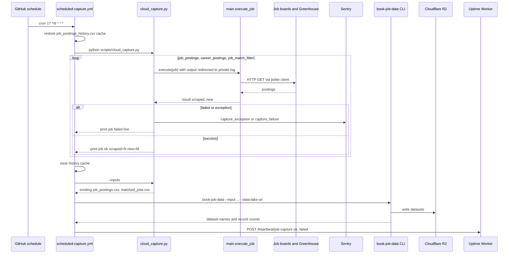
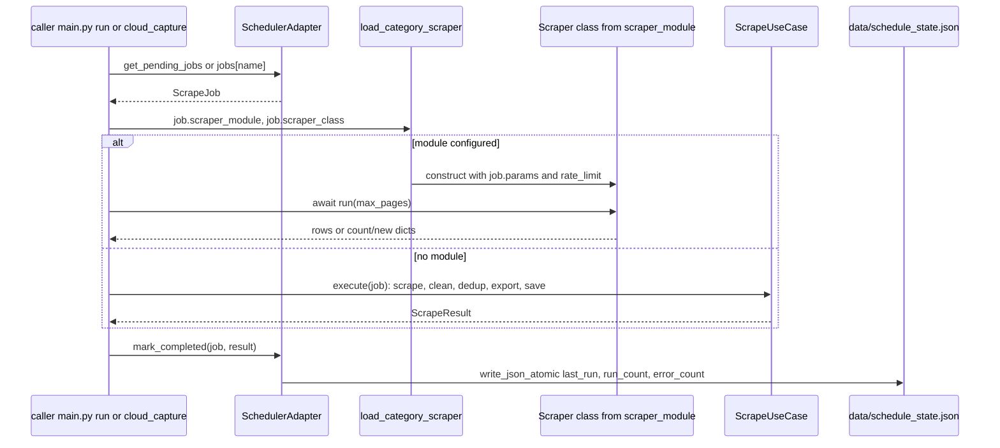
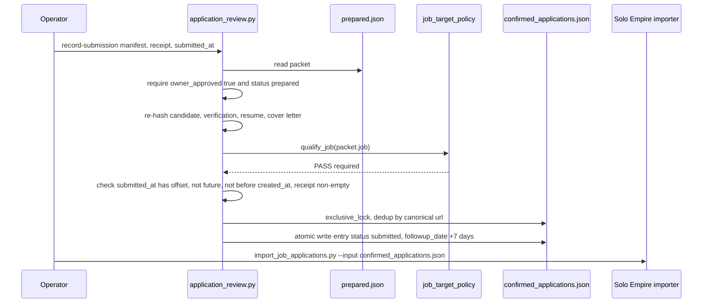

# 10 — Sequences

ลำดับ tick ของ local scheduler มีอยู่แล้วใน [`DOCPACK/02-architecture.md`](../../DOCPACK/02-architecture.md) §5.1 (reused)
ไฟล์นี้เพิ่ม 3 path สำคัญ: hosted capture run, การ execute job หนึ่งตัว และ record-submission

## 1. Hosted capture run (GitHub Actions)

Sources: `.github/workflows/scheduled-capture.yml`, `scripts/cloud_capture.py`, `scripts/_sentry.py`, `main.py`, `scripts/http_policy.py`

## 2. Execute one configured job (main.py)

Sources: `main.py`, `adapters/inbound/scheduler_adapter.py`, `core/use_cases.py`, `core/atomic_io.py`

## 3. Record a manual submission

Sources: `scripts/application_review.py` (`record_submission`), `scripts/job_target_policy.py`, `scripts/file_lock.py`, `CAREER-WORKFLOW.md`

## Open questions

- ไม่มี sequence ของ ingest ภายใน `book-job-data` ในที่นี้ (อยู่ใน repo `career-job-market-data`)
