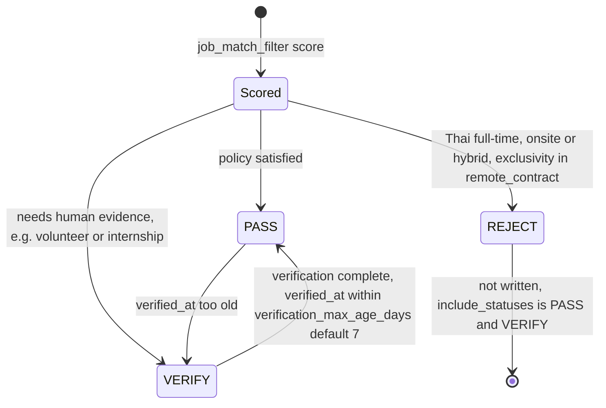
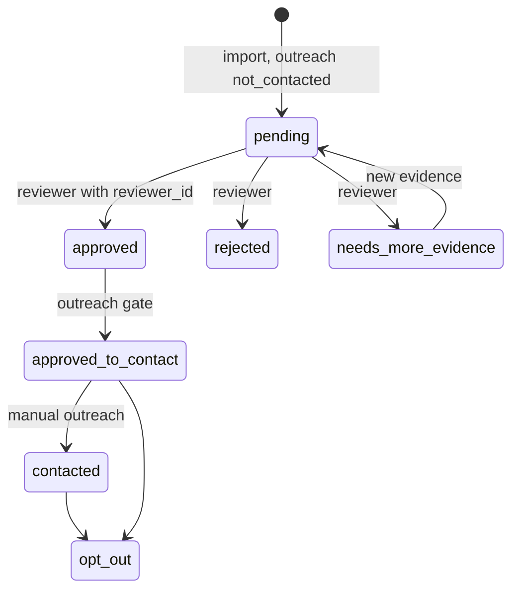
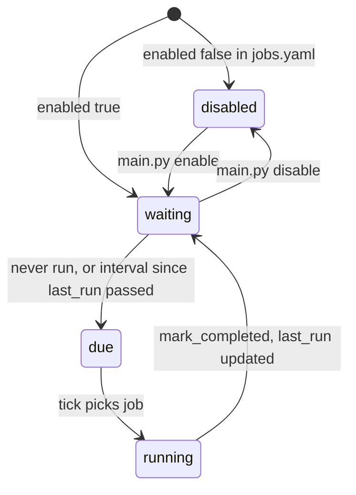

# 11 — State machines

entity ที่มี status / lifecycle field ในโค้ด

## 1. Job qualification (matched_jobs.csv `qualification_status`)

Sources: `scripts/job_target_policy.py`, `scripts/filter_job_matches.py`, `config/jobs.yaml` (`include_statuses`), `DOCPACK/05-srs.md` US-04, US-06

## 2. Application (apply_tracker.csv → prepared.json → confirmed_applications.json)

```mermaid
stateDiagram-v2
  [*] --> discovered: auto_seed_tracker, PASS only
  discovered --> packet: application_review build
  packet --> prepared_approved: prepare --owner-approved, hashes stored
  packet --> prepared: prepare without approval, hashes stored
  prepared --> [*]: not approved, nothing sent; a second prepare in the same directory fails with Prepared packet already exists, so approval needs a new review directory
  prepared_approved --> submitted: record-submission with receipt
  submitted --> followup_due: followup_date = submitted_at + 7 days
```

`auto_apply.py` เขียนได้แค่ `prepared`; `submitted` เกิดได้จาก `record_submission` เท่านั้น
packet ที่ prepare แล้วแก้ไม่ได้: ต้องสร้าง review directory ใหม่

Sources: `scripts/auto_seed_tracker.py`, `scripts/application_review.py`, `scripts/safety.py` (`is_prepared`, `is_submitted`), `SAFETY.md`

Tracker เก่าอีกชุด (`scripts/app_tracker.py` → `data/application_tracker.json`) มี stage: `discovered`, `saved`, `applied`, `screening`, `technical`, `onsite`, `offer`, `accepted`, `rejected`, `withdrawn` (ไม่ได้ตรวจว่ายังใช้งาน)

## 3. Property / Facebook Group lead review

`outreach_status` enum: `not_contacted`, `approved_to_contact`, `contacted`, `opt_out`; `review_decision` enum: `pending`, `approved`, `rejected`, `needs_more_evidence`
SRS: reviewer ไม่สามารถเลื่อนเป็น `approved_to_contact` เองได้ (`DOCPACK/05-srs.md` §1)

Sources: `contracts/property-capture.v1.json`, `contracts/facebook-group-post.v1.json`, `scripts/check_property_social_capture.py`, `scripts/review_facebook_group_posts.py`, `SAFETY.md`

## 4. Scheduled job (ScrapeJob)

Sources: `core/models.py` (`ScrapeJob.is_due`), `adapters/inbound/scheduler_adapter.py`, `main.py`

## Open questions

- ใครเป็นผู้เลื่อน `approved` → `approved_to_contact` ได้ และมีสคริปต์ใดเขียนสถานะ `contacted` (ไม่พบในรอบนี้)
- transition `prepared` → `prepared_approved` จริงคือ field `owner_approved` ใน packet ใหม่ (packet เดิมแก้ไม่ได้): ต้องสร้าง review dir ใหม่เพื่อ approve หรือไม่
