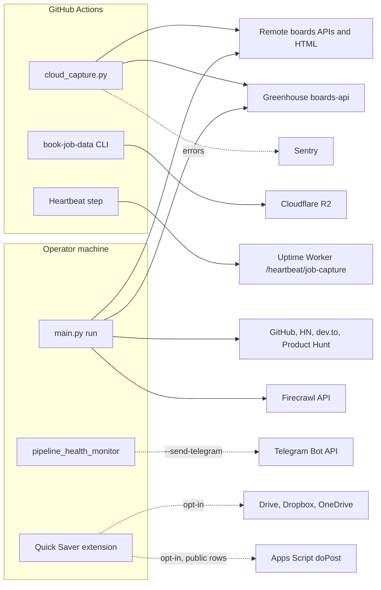

# 12 — API & integrations

repo นี้ **ไม่มี HTTP endpoint ของตัวเอง** (ไม่มี server; `DOCPACK/02-architecture.md` §6)
endpoint เดียวที่ "รับ" คือ Apps Script `doPost` ใน `integrations/google-sheet/Code.gs` ซึ่ง operator deploy เองในบัญชี Google ของตน
ส่วน "interface" ขาเข้าอื่นคือ CLI (`main.py run|loop|status|enable|disable`) และ MCP tools

## Inbound interfaces

| Interface | Input | Output | Auth |
|---|---|---|---|
| `main.py run [JOB]`, `status`, `enable`, `disable`, `loop` | job name | `data/` files, `schedule_state.json` | local shell |
| `scripts/cloud_capture.py` / `--inputs` | `config/jobs.yaml` | status lines / list of ingest files | Actions secrets |
| `application_review.py build / prepare / record-submission` | matched CSV, packet dir, receipt | packets, ledger | local shell + `--owner-approved` |
| MCP tools `search_jobs`, `search_businesses`, `get_product_prices`, `get_news` | keyword, filters, limit | list of dicts from `data/<collection>/items.json` | local process |
| Apps Script `doPost` (raw_posts) | JSON `{secret, rows[]}` max 2000 rows | `{ok, added}` or `forbidden` / `bad_json` | shared `SECRET` script property |

## Outbound integrations

| Integration | Called from | Method / endpoint | Credential | Runs where |
|---|---|---|---|---|
| Remote boards (Remotive, WWR, RemoteOK, Himalayas, Jobicy, HN Algolia, Working Nomads, The Muse, Arc, Fastwork, PeoplePerHour) | `scripts/scrape_job_postings.py` via `PoliteHttp` | HTTP GET (API or HTML) | none | hosted + local |
| Greenhouse Job Board API | `scripts/career_discovery.py` | GET `boards-api.greenhouse.io` per board in `config/career_sources.yaml` | none | hosted + local |
| GitHub search API, HN Firebase, dev.to API, Product Hunt feed | `scrape_github_trending.py`, `scrape_hackernews.py`, `scrape_devto.py`, `scrape_producthunt.py` | GET | none in config | local |
| Firecrawl | `scripts/scrape_property_listings.py` | POST `api.firecrawl.dev/v1/search` | `FIRECRAWL_API_KEY` | local |
| book-job-data CLI → R2 | `scheduled-capture.yml` step Ingest | `book-job-data --input ... --data-lake-uri` (S3 API) | `JOB_DATA_R2_*`, `JOB_DATA_S3_ENDPOINT`, `JOB_DATA_LAKE_URI` | hosted |
| Uptime Worker | step Heartbeat | POST `monitor.bookchaowalit.com/heartbeat/job-capture` | `HEARTBEAT_TOKEN` bearer | hosted |
| Sentry | `scripts/_sentry.py` | sentry-sdk | `SENTRY_DSN` | hosted |
| Telegram Bot API | `pipeline_health_monitor.py --send-telegram`, `auto_seed_tracker.py`, other `--send-telegram` scripts | POST `api.telegram.org/bot.../sendMessage` | `TELEGRAM_NOTI_BOT_TOKEN` or `TELEGRAM_BOT_TOKEN` | local, opt-in flag |
| Google Drive / Dropbox / OneDrive | `chrome-extension/cloud.js` | OAuth via `chrome.identity`, upload APIs | operator OAuth, client ID in options | operator browser, opt-in |
| Apps Script web app | `chrome-extension/sheet.js` | POST `script.google.com/macros/s/<id>/exec` | shared secret | operator browser, opt-in |
| Brave Search API | `scripts/scrape_property_social.py` | GET `api.search.brave.com/res/v1/web/search` | `BRAVE_SEARCH_API_KEY` | disabled (`enabled: false`) |

Sources: `config/jobs.yaml`, `config/career_sources.yaml`, `scripts/scrape_job_postings.py`, `scripts/career_discovery.py`, `scripts/scrape_property_listings.py`, `scripts/scrape_property_social.py`, `scripts/pipeline_health_monitor.py`, `scripts/auto_seed_tracker.py`, `scripts/_sentry.py`, `.github/workflows/scheduled-capture.yml`, `mcp_server/server.py`, `chrome-extension/cloud.js`, `chrome-extension/sheet.js`, `integrations/google-sheet/Code.gs`, `RUNBOOK.md` §Configure

## Open questions

- `uptime Worker` เก็บ config target `job-capture` ใน repo อื่น (`platform-uptime-worker src/targets.ts` ตาม `RUNBOOK.md` §Rollback): ค่าความเงียบ 13 ชม. ยืนยันจาก RUNBOOK/spec เท่านั้น
- `scrape_job_postings.py` ยังมี URL ของบอร์ดที่ไม่อยู่ใน `boards` (Indeed, Dice, JobThai, JobsDB, Seek, workatastartup ฯลฯ): เป็น dead code หรือเปิดได้ผ่าน param
