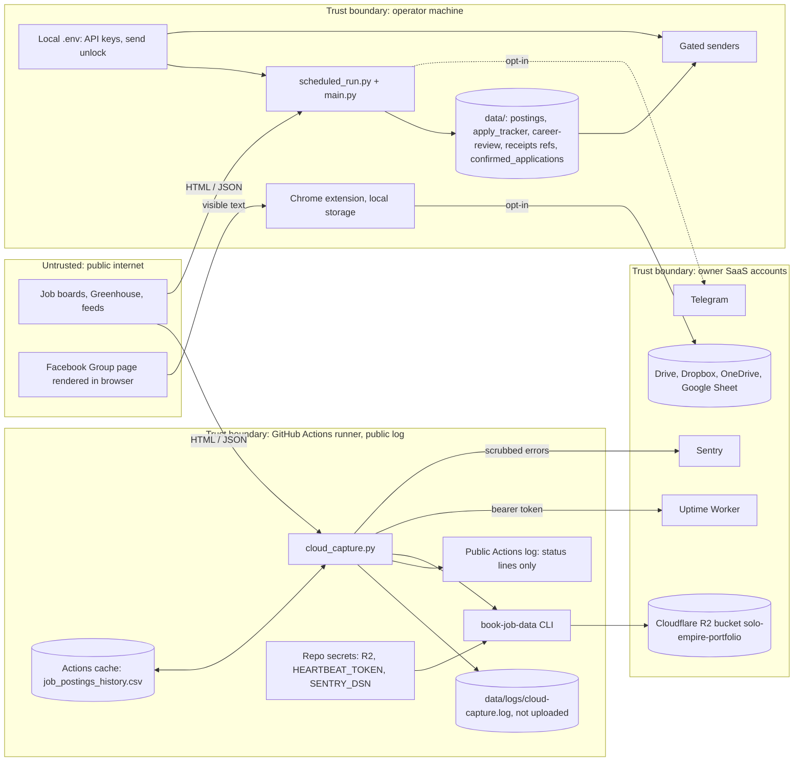

# 13 — Threat model (DFD + STRIDE)

ต่อยอดจาก [`DOCPACK/03-nfr-security.md`](../../DOCPACK/03-nfr-security.md) §2 (SEC-01..SEC-10) และ `SAFETY.md`

## DFD with trust boundaries

Sources: `.github/workflows/scheduled-capture.yml`, `scripts/cloud_capture.py`, `scripts/_sentry.py`, `scripts/scheduled_run.py`, `scripts/safety.py`, `chrome-extension/manifest.json`, `chrome-extension/cloud.js`, `chrome-extension/sheet.js`, `integrations/google-sheet/Code.gs`, `RUNBOOK.md`, `SAFETY.md`

## STRIDE per element

| Element | Threat (STRIDE) | Existing mitigation (in code/config) | Gap |
|---|---|---|---|
| Hosted capture runner | **I** job titles, keywords, URLs leak to public log | fd 1/2 redirected to `cloud-capture.log` (`_to_log`), status line ≤ 200 chars; `tests/test_cloud_capture.py` | error text up to 200 chars still printed; exception messages could carry data |
| Hosted capture runner | **I** private tracker on runner | `PARAM_OVERRIDES seed_tracker=False`, `INGEST_FILES` excludes `apply_tracker.csv` | — |
| Hosted capture runner | **T** supply chain (deps, actions) | `uv sync --frozen` from `uv.lock`; actions pinned by SHA; `BOOK_JOB_DATA_REF` pinned; `security.yml` gitleaks, semgrep, osv-scanner, trivy; Renovate | `book-job-data` installed with `pip` from tarball without hash check |
| Repo secrets | **I / E** token theft or overuse | `permissions: contents: read`; `persist-credentials: false`; R2 token scoped to bucket `solo-empire-portfolio` (`RUNBOOK.md`) | R2 key is write-capable; no rotation schedule found in repo |
| Actions cache | **T** poisoned history alters `new=` counts | cache key per run; only public postings | none beyond GitHub cache scoping |
| Sentry | **I** PII or secrets in events | allowlist `scrub_event`, `send_default_pii=False`, no locals/breadcrumbs; `tests/test_sentry_scrub.py` | — |
| Uptime Worker heartbeat | **S** forged ok heartbeat hides outage | bearer `HEARTBEAT_TOKEN` | — |
| Board responses (untrusted input) | **T / D** malformed HTML, huge payloads, slow hosts | `PoliteHttp` per-host spacing, retry ≤ 3, `Retry-After` ≤ 60 s, circuit breaker; `career_discovery` `MAX_BYTES` 12 MB; step timeouts 45 + 5 min local, 30 min hosted | — |
| Local data/ | **I** applicant PII, receipts | gitignored; packets store hashes and paths; ledger keeps references only | no encryption at rest; no backup off-machine (see 14) |
| Gated senders | **E / R** accidental live send, repudiation | flag + `BOOK_JOB_LIVE_SEND_ENABLED` + `BOOK_JOB_SEND_UNLOCK` + PASS + APPROVED; immutable `prepared.json` hashes; receipt required | — |
| Local env / process | **E** command injection via subprocess | `tests/test_process_security.py` | scope not documented (DOCPACK SEC-10) |
| Chrome extension | **I / E** broad page access | no `<all_urls>` since 1.4.0; host_permissions = listed boards + cloud APIs; tokens in `chrome.storage.session` | `scripting` + `activeTab` still grant per-tab script injection |
| Apps Script doPost | **S / T** anyone posts rows | shared `SECRET` compare, max 2000 rows, `LockService`, formula guard `cell_()` | web app is "Anyone" access; secret sent in body, compared with `!==` (not constant-time) |
| Facebook / property lane | **I** third-party personal data (PDPA) | `pending` / `not_contacted` defaults; private/unknown quarantined; retention + terms refs required; Brave job disabled | terms/PDPA approvals recorded outside repo |

Sources: `scripts/cloud_capture.py`, `scripts/_sentry.py`, `scripts/http_policy.py`, `scripts/career_discovery.py`, `scripts/scheduled_run.py`, `scripts/safety.py`, `scripts/application_review.py`, `.github/workflows/ci.yml`, `.github/workflows/scheduled-capture.yml`, `renovate.json`, `chrome-extension/manifest.json`, `chrome-extension/cloud.js`, `integrations/google-sheet/Code.gs`, `contracts/*.json`, `tests/test_process_security.py`, `tests/test_sentry_scrub.py`, `tests/test_paths_and_safety.py`

## Open questions

- `DOCPACK/03-nfr-security.md` SEC-07 ยังบอกว่ามี `<all_urls>`; manifest 1.5.0 ไม่มีแล้ว: ควรอัปเดต DOCPACK
- มีแผน rotate R2 key `book-job-data-capture` และ `HEARTBEAT_TOKEN` หรือไม่
- ควร pin `book-job-data` ด้วย hash (`--require-hashes`) หรือไม่
