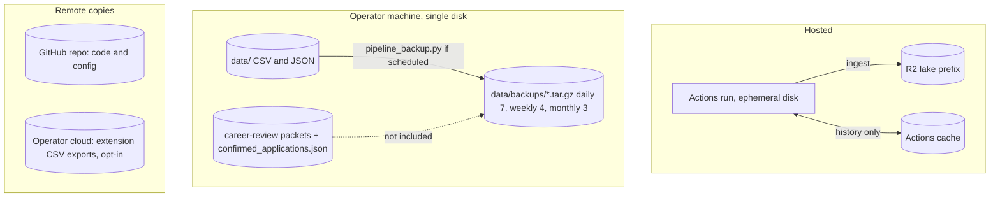

# 14 — Backup & DR

ต่อยอดจาก [`DOCPACK/03-nfr-security.md`](../../DOCPACK/03-nfr-security.md) §5 (ซึ่งยังเป็น [ต้องยืนยัน])

## Data inventory

| Data | Where it lives | Regenerable? | Backup reality found in repo |
|---|---|---|---|
| `job_postings.csv`, `career_postings.csv`, `matched_jobs.csv` (hosted) | runner, discarded each run; copies ingested to R2 `portfolio-demo/book-job-data-001` | yes, next run (expired postings lost) | R2 is the durable copy; bucket-level backup not defined here |
| `job_postings_history.csv` (hosted) | Actions cache, key `capture-history-<run_id>` | partly: only affects `new=` counts | cache only (GitHub evicts unused caches) |
| Same CSVs (local) | operator `data/` | yes | `scripts/pipeline_backup.py` tar.gz to `data/backups/` (same disk) if run |
| `apply_tracker.csv`, `job_descriptions.csv`, JSON logs | operator `data/` | partly | in `pipeline_backup.py` `BACKUP_FILES` |
| `career-review/<dir>/<JOB_ID>/` packets, `confirmed_applications.json` | operator `data/` | **no** (evidence of submissions) | **not** in `BACKUP_FILES`; no off-machine copy |
| Resume / cover letter / receipts | operator private paths referenced by hash | no | outside repo scope |
| `schedule_state.json`, `hash_db.json`, `data/<collection>/items.json` | operator `data/` | yes | atomic writes protect against a killed tick, not disk loss |
| Extension saved rows | `chrome.storage.local` | no until exported | opt-in upload of exported CSV to Drive/Dropbox/OneDrive |
| FB Group `raw_posts` Sheet | operator Google Sheet | no | Google-side only |
| Code + config | GitHub `bookchaowalit/career-job-scraper` | — | Git remote |

Sources: `.github/workflows/scheduled-capture.yml`, `scripts/cloud_capture.py`, `scripts/pipeline_backup.py` (`BACKUP_DIR`, `BACKUP_FILES`, `RETENTION`), `scripts/pipeline_runner.py` (step `pipeline_backup`), `core/atomic_io.py`, `chrome-extension/cloud.js`, `DOCPACK/02-architecture.md` §4

## Restore paths

- Hosted: ไม่มี state ต้อง restore; รัน `gh workflow run scheduled-capture.yml` แล้ว R2 ได้ capture ใหม่ (`RUNBOOK.md`)
- Local: `python3 scripts/pipeline_backup.py --restore` แสดงรายการ / `--restore FILE` คืนจาก archive
- Hosted rollback: `gh workflow disable scheduled-capture.yml` + เอา heartbeat ออก (`RUNBOOK.md` §Rollback)

## RTO / RPO

**not defined** (ไม่มีใน `RUNBOOK.md`, spec หรือ KPI plan)
ค่าที่ใกล้เคียงที่สุดที่เขียนไว้: KPI-O-01 target ความสด ≤ 8 ชม. และ heartbeat alert เมื่อเงียบ > 13 ชม. (`docs/measurement/KPI-PLAN.md`) ซึ่งเป็นเรื่อง freshness ไม่ใช่ RPO

## Open questions

- `pipeline_backup.py` ถูก schedule จริงหรือไม่: อยู่ใน `pipeline_runner.py` แต่ไม่อยู่ใน `config/jobs.yaml` หรือ `scheduled_run.py` `STEPS`
- ควรสำรอง `career-review/` และ `confirmed_applications.json` ออกนอกเครื่องหรือไม่ (DOCPACK เสนอเป็นสมมติฐาน)
- R2 prefix มี versioning / lifecycle / backup ของฝั่ง `book-job-data` หรือไม่ (ไม่อยู่ใน repo นี้)
- RTO/RPO ที่ owner ยอมรับได้
