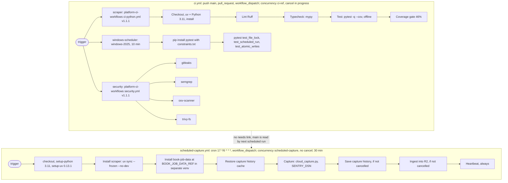

# 15 — CI/CD pipeline

สอง workflow ใน `.github/workflows/`: `ci.yml` (quality + security gate) และ `scheduled-capture.yml` (production run = capture + publish)
ไม่มี workflow ที่ "deploy code": capture รอบถัดไป checkout `main` ล่าสุดเอง

Sources: `.github/workflows/ci.yml`, `.github/workflows/scheduled-capture.yml`, `bookchaowalit/platform-ci-workflows` `.github/workflows/ci-python.yml` and `security.yml` at `87dc5e1c` (job and step names read via `gh api`), `pytest.ini`, `ruff.toml`, `pyproject.toml`, `constraints.txt`, `renovate.json`

หมายเหตุ: CI ไม่ได้เป็น gate ของ capture: ถ้า CI แดงบน `main`, capture รอบถัดไปก็ยังรันโค้ดนั้น (ไม่มี `needs` หรือ `workflow_run`)

## Open questions

- ต้องการให้ capture รันเฉพาะ SHA ที่ CI เขียวหรือไม่
- `tests/js/*.test.js` รันใน CI หรือไม่: `tests/test_chrome_extension_cloud_upload.py` เรียก `node --test` แบบ `skipUnless(node)` ขึ้นกับว่า runner ของ shared workflow มี node
- Renovate (`renovate.json`) เปิด PR จริงบน repo นี้หรือไม่ (ไม่พบ PR ใน `gh run list` ช่วงนี้)
