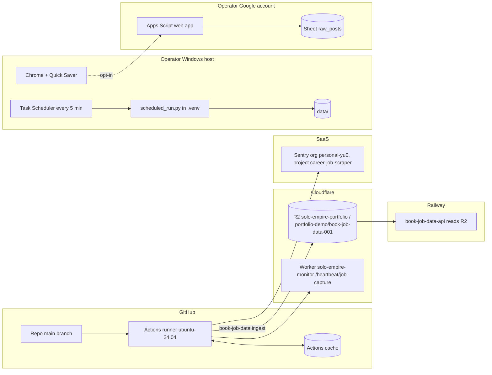

# 16 — Deployment

ไม่มี public URL, server หรือ container (Tier A tool) มีสอง runtime:

| Runtime | Host | Env / config | Data store |
|---|---|---|---|
| Hosted capture | GitHub-hosted `ubuntu-24.04`, repo `bookchaowalit/career-job-scraper` (public) | repo secrets: `SENTRY_DSN`, `JOB_DATA_LAKE_URI`, `JOB_DATA_S3_ENDPOINT`, `JOB_DATA_R2_ACCESS_KEY_ID`, `JOB_DATA_R2_SECRET_ACCESS_KEY`, `HEARTBEAT_TOKEN`; source of truth Infisical `/job-data`, `/monitoring` (`RUNBOOK.md`) | R2 bucket `solo-empire-portfolio`, prefix `portfolio-demo/book-job-data-001` |
| Local scheduler | operator Windows host (Task Scheduler `book-job-scraping-scheduler`, every 5 min, `.venv\Scripts\pythonw.exe`); Linux alternative `setup_cron.sh` | local `.env` loaded by `main.py` | `data/` on local disk |
| Chrome extension | operator Chrome profile, unpacked MV3 1.5.0 | options page: cloud client IDs, Sheet URL + secret | `chrome.storage.local` / `.session` |
| Sheet receiver | operator Google account, Apps Script web app | script properties `SECRET`, `SPREADSHEET_ID` | Google Sheet tab `raw_posts` |

Sources: `.github/workflows/scheduled-capture.yml`, `ops/windows/scheduled-task.ps1`, `setup_cron.sh`, `scripts/scheduled_run.py`, `main.py`, `chrome-extension/manifest.json`, `integrations/google-sheet/Code.gs`, `RUNBOOK.md` §Hosted job capture, `docs/measurement/KPI-PLAN.md` §Dashboards, `specs/cloud-capture-pipeline.md` §Context

## Open questions

- Local Task Scheduler ยัง install และรันอยู่บนเครื่อง operator วันนี้หรือไม่ (RUNBOOK บอกว่า local scheduler เป็น optional ตั้งแต่ 2026-10-21)
- URL ของ `book-job-data-api` บน Railway ไม่อยู่ใน repo นี้
- `ops/systemd/*.example` (FB background capture) ถูก deploy ที่ใดหรือไม่
