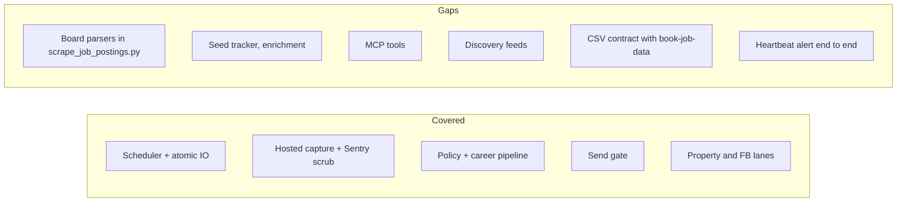

# 17 — Test coverage matrix

test ทั้งหมดอยู่ใน `tests/` (pytest + unittest, ใช้ fixture offline) และ `tests/js/*.test.js` (node --test)
ไม่มี e2e กับ source จริง; "integration" = fixture ข้ามหลายโมดูล หรือ subprocess/filesystem จริง
coverage gate ใน CI = 46% (`ci.yml`, วัด 46.70% เมื่อ 2026-10-23)

| Feature | Unit | Integration (fixture / subprocess) | E2E | Test files (count of `def test_`) |
|---|---|---|---|---|
| Scheduler tick, lock, timeout, rotation | yes | yes (kills grandchild process, Windows CI) | no | `test_scheduled_run.py` (6), `test_file_lock.py` (1) |
| Atomic writes / JSON log recovery | yes | yes (hard-kills child in `save()`) | no | `test_atomic_writes.py` (5), `test_json_log_recovery.py` (10) |
| Hosted capture runner | yes | yes (private log fd redirect) | no | `test_cloud_capture.py` (11) |
| Sentry scrub | yes | — | no | `test_sentry_scrub.py` (6) |
| HTTP politeness | yes | — | no | `test_http_policy.py` (7) |
| Remote board capture / history dedup | partial | — | no | `test_job_history_dedup.py` (2); board parsers in `scrape_job_postings.py` **untested** |
| Greenhouse discovery → match → review → prepare → record | yes | yes (fixture E2E pipeline) | no | `test_career_pipeline.py` (14) |
| Targeting policy | yes | — | no | `test_job_target_policy.py` (27) |
| Send gate / paths | yes | — | no | `test_paths_and_safety.py` (17), `test_process_security.py` (3) |
| Source coverage registry | yes | — | no | `test_source_coverage.py` (2) |
| Health staleness | yes | — | no | `test_health_staleness.py` (2) |
| Core cleaner, dedup, use cases, storage | yes | yes (temp dirs) | no | `test_core_pipeline.py` (21), `test_use_cases_and_storage.py` (13), `test_bug_pattern_sweep.py` (15) |
| Description enrichment (FR-05) | **gap** | **gap** | no | — |
| Seed tracker (FR-06) | **gap** | **gap** | no | — |
| Draft generators (FR-08) | partial via safety tests | — | no | `test_paths_and_safety.py` |
| MCP tools (FR-15) | **gap** (SearchUseCase only) | — | no | `test_use_cases_and_storage.py` |
| Discovery feeds + scraper dashboard (FR-17) | **gap** | — | no | — |
| Property portals, ddproperty, tgcondo, demand, social | yes | fixtures | no | `test_property_*.py` (10 files), `test_ddproperty_scraper.py` (5), `test_tgcondo_rss.py` (5) |
| Facebook Group capture / background | yes | fixtures | no | `test_facebook_group_capture.py` (8), `test_facebook_group_background.py` (15) |
| Chrome extension (JS) | yes | node tests via Python wrapper | no | `test_chrome_extension_cloud_upload.py` (11), `test_chrome_extension_property_capture.py` (6), `tests/js/*.test.js` (5 files) |
| Migrated/retired feeds kept in repo | yes | fixtures | no | `test_crypto_prices.py`, `test_exchange_rates.py`, `test_stock_prices.py`, `test_defi_yields.py`, `test_ai_tools.py`, `test_seo_rankings.py`, `test_flights_retired.py` |
| Python 3.11 syntax guard | yes | — | no | `test_python_311_syntax.py` (1) |
| CSV contract with book-job-data (FR-13) | **gap** | **gap** | no | — |
| Heartbeat alert fires (SPEC-CAP-07) | **gap** | **gap** | **gap** | — |

Sources: `tests/*.py` (counts from `grep -c "def test_"`), `tests/js/`, `tests/conftest.py`, `pytest.ini`, `.github/workflows/ci.yml`, `DOCPACK/07-test-uat.md`, `DOCPACK/08-rtm.md`

## Open questions

- คอมเมนต์ใน `ci.yml` บอกว่ามี "network guard in tests/conftest.py" แต่ `tests/conftest.py` ปัจจุบันตั้งแค่ `PYTHONUTF8=1`: guard อยู่ที่อื่นหรือหายไป

- coverage ต่อโมดูลไม่ได้ถูกเก็บใน repo (CI รัน `--cov-report=` ว่าง): ต้องการรายงานต่อ module หรือไม่
- `tests/js/` รันใน CI จริงไหม (ขึ้นกับ node บน runner ของ shared workflow)
