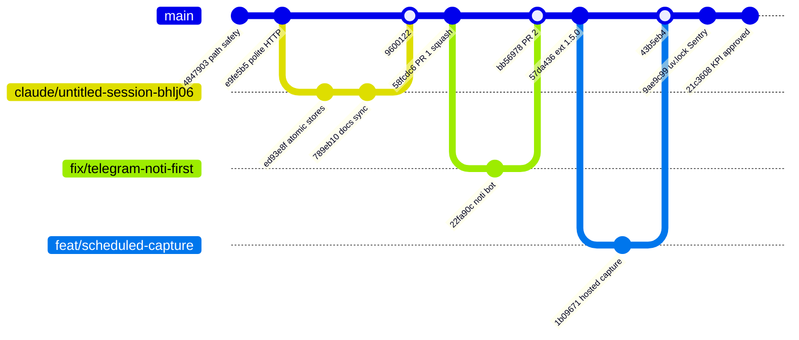
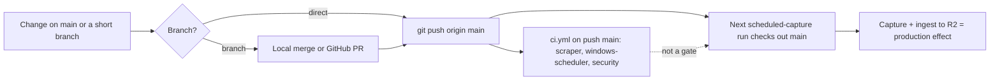

# 18 — Git & release workflow

รูปแบบที่เห็นจาก `git log origin/main` (90 วัน): ส่วนใหญ่ commit ตรงเข้า `main`; บางงานใช้ branch แล้ว merge ในเครื่อง (`Merge branch '...'`) และมี PR บน GitHub 2 ตัว (#1 squash-merged เป็น `58fcdc6`, #2 merge commit `bb56978`)
ไม่มี tag, release หรือ version ของ repo; production = capture รอบถัดไปที่ checkout `main`

Sources: `git log --first-parent origin/main`, `gh pr list -R bookchaowalit/career-job-scraper --state all`, `.github/workflows/ci.yml`, `.github/workflows/scheduled-capture.yml`

หมายเหตุ: ไม่พบ branch protection ใน repo (ไม่อยู่ในไฟล์); `origin` ยังมี branch `claude/untitled-session-bhlj06` และ `fix/telegram-noti-first` ค้างอยู่

## Open questions

- มี branch protection / ruleset บน `main` หรือไม่ (ตรวจจาก repo ไม่ได้)
- ควรลบ remote branch ที่ merge แล้ว 2 ตัวหรือไม่
