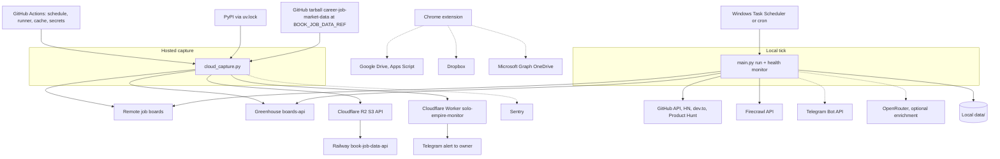

# 19 — Service dependency map

runtime dependency ของแต่ละ runtime; เส้นทึบ = ต้องมีเพื่อให้ผลหลักสำเร็จ, เส้นประ = optional / opt-in

| Dependency | Failure effect | Handling in code |
|---|---|---|
| A board host down | fewer postings that run | `PoliteHttp` retry + circuit breaker per host; other boards continue |
| Greenhouse board fails | career_postings not overwritten | `career_discovery` keeps previous capture when any board fails (`DOCPACK/05-srs.md` US-03) |
| One cloud job raises | run exit 1, later jobs still run | `cloud_capture.run()` |
| R2 / ingest fails | data stale in API | step fails → heartbeat `failed: [ingest]` |
| Uptime Worker unreachable | no alert | `curl -fsS` fails the Heartbeat step only |
| Sentry unreachable | errors not reported | `flush(5)`; run result unaffected |
| GitHub schedule delayed / disabled after 60 days idle | freshness drops | heartbeat silence alert > 13 h |

Sources: `.github/workflows/scheduled-capture.yml`, `scripts/cloud_capture.py`, `scripts/http_policy.py`, `scripts/career_discovery.py`, `scripts/_sentry.py`, `scripts/scheduled_run.py`, `config/jobs.yaml`, `chrome-extension/manifest.json`, `RUNBOOK.md` §Configure, §Hosted job capture

## Open questions

- OpenRouter ใช้จากสคริปต์ใดใน path ที่ schedule จริง (RUNBOOK ระบุเป็น optional enrichment เท่านั้น)
