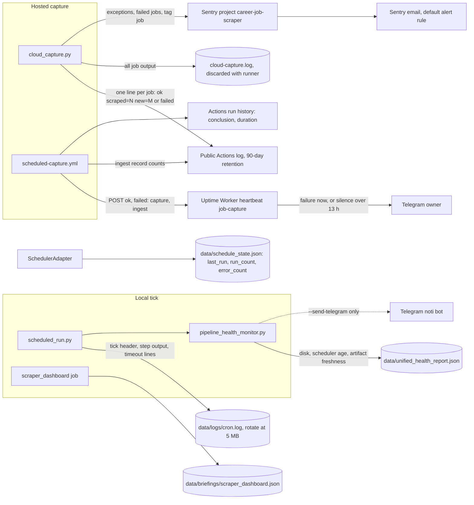

# 20 — Observability

KPI และ instrumentation ของ hosted capture ถูกนิยามแล้วใน [`docs/measurement/KPI-PLAN.md`](../../docs/measurement/KPI-PLAN.md) (reused: KPI tree, baseline, alert)
ไฟล์นี้วาด signal flow ของทั้งสอง runtime จากสิ่งที่โค้ดส่งจริง

Sources: `scripts/cloud_capture.py`, `scripts/_sentry.py`, `.github/workflows/scheduled-capture.yml`, `scripts/scheduled_run.py`, `scripts/pipeline_health_monitor.py` (`HEALTH_REPORT`, `send_telegram`), `config/jobs.yaml` (`scraper_dashboard`), `adapters/inbound/scheduler_adapter.py`, `docs/measurement/KPI-PLAN.md`, `RUNBOOK.md`

## What is watched

| Signal | Watched by | Alert |
|---|---|---|
| Hosted run failed (capture or ingest) | heartbeat `job-capture` | Telegram at once |
| No hosted run for > 13 h | heartbeat silence | Telegram |
| Exception / failed job | Sentry | Sentry email |
| KPI-L-01..03 per-run counts | none (log only) | none |
| Run duration | Actions UI | none |
| Local artifact freshness | `pipeline_health_monitor.py` in each tick | none by default (`STEPS` has no `--send-telegram`) |
| Analytics (PostHog) | not used: no users, no events (`KPI-PLAN.md`) | — |

Measured 2026-11-03 from `gh run list --workflow scheduled-capture.yml --limit 200`: 43 runs since 2026-10-21, all `success`; duration 2.8–4.0 min (median 3.6); gap between run starts median 7.2 h, max 10.0 h (12 gaps over 8 h, all after 2026-10-26)

## Open questions

- KPI-O-01 target "≤ 8 h at any time" ถูกเกินบ่อยตั้งแต่ 2026-10-26 (start gap สูงสุด 10.0 h) เพราะ GitHub เลื่อน schedule: จะปรับ target, cron หรือเพิ่มรอบหรือไม่
- KPI-PLAN verification #5 (heartbeat alert fires on a failure) ยังไม่ทดสอบ
- ไม่มี chart ของ KPI-L-01..03 (`KPI-PLAN.md` §Dashboards)
