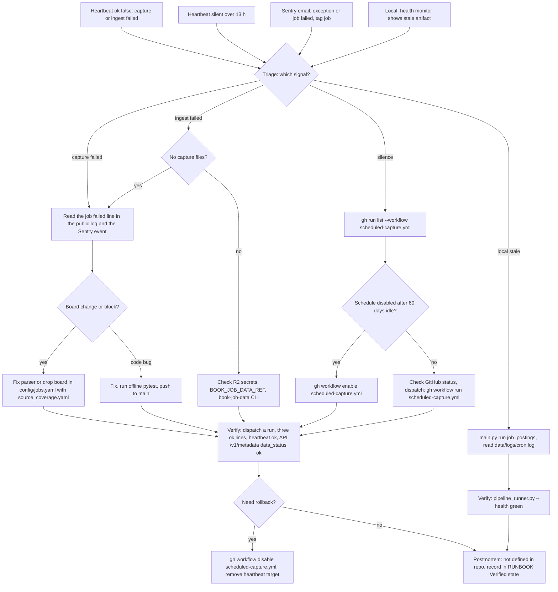

# 21 — Incident response

solo operator ไม่มี on-call หลายคน (`RUNBOOK.md` §Owner) ช่องทาง alert จริงที่พบ: Telegram จาก uptime Worker heartbeat `job-capture` และอีเมลจาก Sentry
ไม่พบ template postmortem หรือ incident log ใน repo นี้

Sources: `.github/workflows/scheduled-capture.yml`, `scripts/_sentry.py`, `scripts/cloud_capture.py`, `scripts/pipeline_health_monitor.py`, `scripts/pipeline_runner.py`, `RUNBOOK.md` §Hosted job capture, §Health check, §Rollback, §Verified state, `specs/cloud-capture-pipeline.md` acceptance scenarios, `docs/measurement/KPI-PLAN.md`

## Open questions

- ต้องการ template postmortem / incident log ที่ไหน (ไม่มีใน repo; RUNBOOK ใช้หัวข้อ "Verified state" แทน)
- Sentry alert rule เป็น default (email) ตาม KPI-PLAN: ต้องการส่งเข้า Telegram ด้วยหรือไม่
