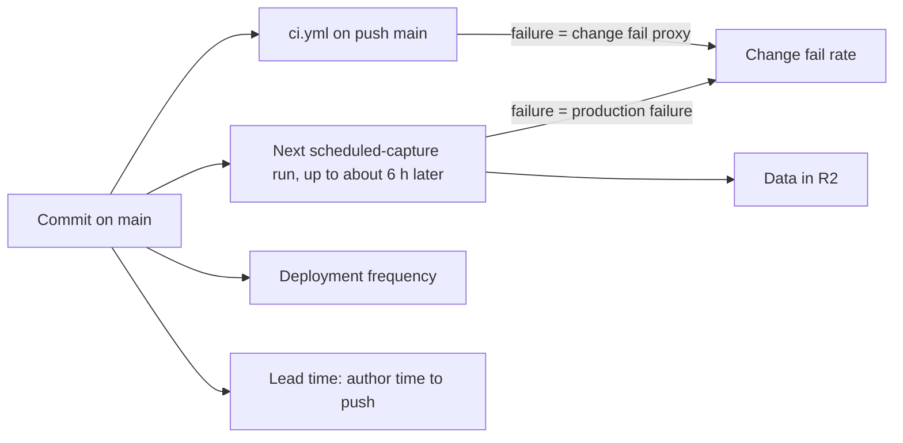

# 22 — DORA metrics

ช่วงวัด: 90 วัน **2026-08-05 → 2026-11-03** (วัดเมื่อ 2026-11-03 จาก clone ที่ `git fetch` แล้ว)

**นิยาม deployment ของ repo นี้:** ไม่มี deploy job; commit ที่เข้า `main` (first-parent) คือ deployment เพราะ `scheduled-capture.yml` รอบถัดไป checkout `main` แล้วรันโค้ดนั้นเพื่อ publish ข้อมูลเข้า R2 (ADR-0001)
ผลของ production run แต่ละรอบ (capture + ingest) ใช้เป็นสัญญาณ "deployment ล้มใน production" ประกอบ

| Metric | How measured here | Value (90 days) | Command |
|---|---|---|---|
| Deployment frequency | first-parent commits on `origin/main` | **41 deploys on 19 distinct days** (≈ 3.2 / week); busiest weeks W42 = 13, W43 = 9; none since 2026-10-24 | `git log --first-parent --since=2026-08-05 --format='%ad' --date=short origin/main \| sort \| uniq -c` |
| Lead time for changes | commit author time → creation of the `ci.yml` push run on `main` that first contains it (CI history exists only from 2026-09-30, so 44 commits since then) | **median ≈ 0 h** (direct pushes), p90 6.7 h, max 83 h (`9afbc85`, docs) | `gh run list --workflow ci.yml --limit 200 --json headSha,createdAt,headBranch,event` + `git log --format='%H %aI' <prev>..<sha>` per run |
| Change fail rate | (a) `ci.yml` push runs on `main` with `conclusion=failure`; (b) `scheduled-capture.yml` runs with `failure` | (a) **4 / 24 = 16.7 %** (`5dd9288`, `43b5eb4`, `dc99de3`, `7a9d8b6`); (b) **0 / 43 = 0 %** (all `success`, 2026-10-21 → 2026-11-03) | `gh run list --workflow ci.yml --limit 200 --json conclusion,headBranch,event`; `gh run list --workflow scheduled-capture.yml --limit 200 --json conclusion` |
| Failed deployment recovery time | time from a red `ci.yml` run on `main` to the next green one | **45 min** (`5dd9288` 13:47 → `40a2a8c` 14:32 UTC, 2026-10-18) and **10.5 min** (`43b5eb4` 16:50 → `543dc2b` 17:01 UTC, 2026-10-21); production: not measurable (no failed capture run) | same `gh run list` output, ordered by `createdAt` |
| Deployment rework rate | first-parent commits on `main` whose subject is a fix or revert (`^fix`, `^Revert`, `Merge branch 'fix/`) | **7 / 41 = 17.1 %** | `git log --first-parent --since=2026-08-05 --format='%h %s' origin/main \| grep -E "^[0-9a-f]+ (fix\|revert\|Revert)\|Merge branch 'fix/"` |

Sources: `git log origin/main`, `gh run list -R bookchaowalit/career-job-scraper` (ci.yml 38 runs, scheduled-capture.yml 43 runs), `.github/workflows/ci.yml`, `.github/workflows/scheduled-capture.yml`

## Caveats

- CI ไม่ใช่ gate ของ capture: CI แดงบน `main` ไม่ได้ทำให้ production run ล้ม (ทั้ง 4 ครั้งเป็นช่วงก่อนหรือระหว่าง hosted capture เริ่ม; capture ไม่เคยล้ม)
- lead time ก่อน 2026-09-30 วัดไม่ได้ (ไม่มี CI run history); ระยะ author → push ของ commit ตรงเข้า `main` ใกล้ 0 เสมอ จึงไม่สะท้อนเวลาทำงานจริง
- rework ใช้ข้อความ commit; `bb56978` (branch `fix/telegram-noti-first`) ไม่ถูกนับเพราะ subject ไม่ขึ้นต้นด้วย fix

## Open questions

- ต้องการนับ deployment เป็น "commit บน main" หรือ "capture run ที่ใช้ SHA ใหม่" (ต่างกันมาก: 41 vs 43 runs ที่ส่วนใหญ่ใช้ SHA เดิม)
- จะเก็บค่าเหล่านี้อัตโนมัติ (เช่น ใน scorecard) หรือคำนวณมือรายไตรมาส
